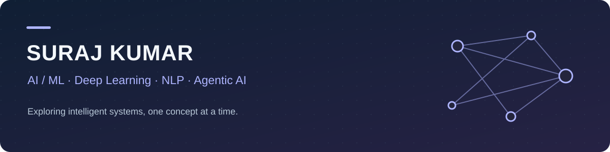

  <a href="https://www.linkedin.com/in/suraj-kumar-44296b352/">LinkedIn</a> &nbsp;·&nbsp;
  <a href="https://leetcode.com/u/SurajxYoddha/">LeetCode</a> &nbsp;·&nbsp;
  <a href="https://github.com/munixdelta?tab=repositories">Projects</a>

## Hi, I'm Suraj 👋

I'm a **B.Tech Computer Science and Artificial Intelligence student** at **KIET Group of Institutions, Ghaziabad**.

My interests include **AI/ML, Deep Learning, Natural Language Processing, Agentic AI, and AWS Cloud**. I'm currently learning **Agentic AI and NLP**, exploring the concepts through code and practical projects.

### What I'm exploring

- Agentic AI, retrieval-augmented generation (RAG), and tool calling.
- Natural Language Processing and deep learning.
- Computer vision applications for pedestrian and vehicle safety.
- AWS Cloud and the foundations of building AI applications.

### Selected projects

| Project | Focus |
| :--- | :--- |
| [Pedestrian & Vehicle Safety System](https://github.com/munixdelta/pedestrian-vehicle-safety-system) | Computer vision for pedestrian detection, vehicle tracking, risk analysis, and a FastAPI dashboard using YOLOv8 and ByteTrack. |
| [Medical Counterfeit Detection](https://github.com/UtkarshSingh368/Medical_Counterfiet_Detection/tree/main/counterfeit_auth-main) | Medical counterfeit detection project repository, hosted by [UtkarshSingh368](https://github.com/UtkarshSingh368). |
| [AI Civic Complaint System](https://github.com/munixdelta/AI_Civic_Complaint_System) | Project repository focused on AI-assisted civic complaint handling. |
| [Agentic AI Learning](https://github.com/munixdelta/AGENTIC_AI_IN_TRIAL) | Day-wise Python learning exercises in Agentic AI and RAG. |
| [LeetCode Logs](https://github.com/munixdelta/LEETCODE_LOGS) | C++ problem-solving practice and coding progress. |

### Learning interests

**AI & ML:** Machine Learning · Deep Learning · NLP · Agentic AI · Computer Vision  
**Cloud:** AWS  
**Project tools:** Python · YOLOv8 · ByteTrack · FastAPI

### Connect with me

Connect on [LinkedIn](https://www.linkedin.com/in/suraj-kumar-44296b352/) or find my coding practice on [LeetCode](https://leetcode.com/u/SurajxYoddha/).
